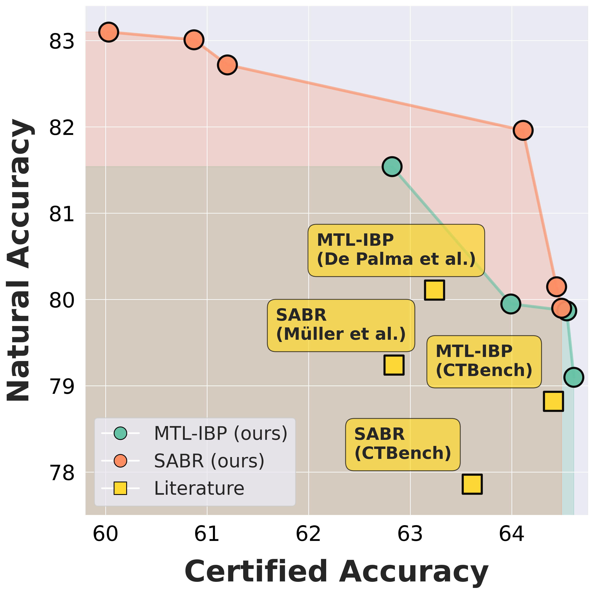

<p align="center">
  
</p>

<h1 align="center">CTRAIN</h1>

<p align="center">
  <strong>A training and evaluation library for certifiably robust neural networks.</strong>
</p>

<p align="center">
  <a href="LICENSE">MIT License</a> ·
  <a href="docs/index.md">Documentation</a> ·
  <a href="docs/examples/README.md">Examples</a> ·
  <a href="papers/rethinking_evaluation_paradigms/README.md">Paper Artifacts</a>
</p>

CTRAIN is a unified, modular and comprehensive Python library for certified training and neural network verification. It provides implementations of state-of-the-art certified training methods through a consistent interface, facilitating their application, comparison and extension. Based on PyTorch and auto_LiRPA, CTRAIN supports configuring, training and formally evaluating neural networks within existing machine learning workflows.

Beyond local robustness for image classification, CTRAIN supports training for general input-output properties, expressed as Boolean combinations of affine output constraints over input boxes. The library also integrates hyperparameter optimisation and complete verification, providing a common workflow from model configuration to formal evaluation.

## 🚀 Why CTRAIN?

Certified training combines demanding optimisation, bound computation, model design and verification. CTRAIN brings these components together in a reusable workflow: choose a training method, wrap a PyTorch model, train with the desired objective and evaluate the resulting network through adversarial attacks or formal verification.

The library supports day-to-day experimentation as well as reproducible research. Start with a certified training run in a few lines of code, use the same wrapper interface across methods, and explore natural/certified accuracy trade-offs through multi-objective hyperparameter optimisation.

## ✨ Highlights

- **Unified training interface:** configure a method wrapper and call `train_model`, with shared schedules, regularisation and checkpointing.
- **Comprehensive method coverage:** IBP, CROWN-IBP, SABR, TAPS, STAPS, expressive losses, CC-Dist, IBP-R, Gaussian loss smoothing and set-based training.
- **Built on PyTorch and auto_LiRPA:** reuse standard models, data loaders, automatic differentiation and bound propagation within existing workflows.
- **Beyond local robustness:** train for [general input-output properties](docs/properties.md), including affine comparisons, conjunctions and disjunctions over declared input regions.
- **Adversarial and formal evaluation:** PGD and AutoAttack, incomplete IBP/CROWN/forward bounds, and complete verification through α,β-CROWN and NeuralSAT.
- **Automated hyperparameter optimisation:** method-specific search spaces, scalar Optuna/SMAC3 searches and natural/certified accuracy Pareto fronts with Optuna/BoTorch.
- **Examples and documentation:** simple getting-started notebooks, detailed method guides and an API reference for extending the library.
- **Open source:** project code is distributed under the MIT License.

## 📚 Supported Methods

The following training methods are available through method-specific model wrappers. Their documentation explains the objectives, configuration options and implementation details.

- [IBP](docs/ibp.md): interval bound propagation with the initialisation and regularisation improvements of Shi et al.
- [CROWN-IBP](docs/crown_ibp.md): combine backward linear-relaxation bounds with IBP intermediate bounds.
- [SABR](docs/sabr.md): train over small adversarially selected bounding regions.
- [TAPS and STAPS](docs/taps_staps.md): combine feature bounds with latent adversarial search; STAPS additionally uses SABR subregions.
- [MTL-IBP, CC-IBP and Exp-IBP](docs/expressive_losses.md): combine adversarial and bound-based objectives through expressive losses.
- [CC-Dist](docs/cc_dist.md): combine CC-IBP with feature distillation from an adversarially trained teacher.
- [IBP-R](docs/ibp_r.md): add an IBP-based ReLU-relaxation regulariser to adversarial training.
- [Gaussian loss smoothing](docs/gls.md): smooth training objectives over network parameters using RGS or PGPE.
- [Set-based training](docs/set_based.md): propagate zonotopes and optimise the resulting output enclosure.

These methods reuse shared implementations of bound propagation, losses, adversarial attacks and regularisation. To investigate a new approach, users can modify individual components while retaining the surrounding training and evaluation workflow.

For [general input-output properties](docs/properties.md), `PropertyModelWrapper` combines a supplied task loss with satisfaction-margin objectives over declared input regions. Supported strategies include bound-based training and adaptations of expressive losses, SABR, IBP-R and Gaussian loss smoothing.

### 🛡️ Evaluation and Verification

CTRAIN supports PGD and AutoAttack for adversarial evaluation, and IBP, CROWN-IBP, CROWN, α-CROWN and forward LiRPA bounds for incomplete verification. Adaptive evaluation applies bounding methods with increasing tightness to inputs left unresolved by earlier methods.

[Complete verification](docs/complete_verification.md) integrates α,β-CROWN and NeuralSAT. CTRAIN screens inputs using incomplete bounds and attacks, then exports unresolved queries through ONNX and VNNLIB for the selected backend. Certified and adversarial accuracies provide lower and upper bounds on robust accuracy; timeouts remain unresolved. See the [evaluation guide](docs/guides/evaluation.md) for the available methods and result semantics.

## ⚙️ Installation

First, install CTRAIN and its pinned Git-hosted dependencies:

```bash
python -m pip install CTRAIN
ctrain-install-git-deps
```

The second command installs the auto_LiRPA, ONNX converter and AutoAttack revisions used by CTRAIN and requires network access. Run it in the same Python environment as your training scripts or notebook kernel.

For development, run the following commands from the repository root:

```bash
git submodule update --init --recursive
python -m pip install -e ".[dev]"
ctrain-install-git-deps
```

The reference CPU environment uses Python 3.11, PyTorch 2.3.1 and torchvision 0.18.1. Match PyTorch and torchvision to each other and your CPU or CUDA environment. NeuralSAT requires Python 3.10 or newer. Further details are provided in [getting started](docs/getting_started.md#installation) and [dependency troubleshooting](docs/guides/troubleshooting.md#dependency-and-interpreter-mismatches).

## 🧪 Quick Start

In the following example, we train the CNN7 architecture proposed by Shi et al. on MNIST using IBP. We want the model to be certifiably robust against ℓ∞ perturbations with radius ε = 0.1. First, we load the dataset and construct the model. Now, we wrap it with the training configuration, call `train_model` and evaluate the resulting network:

```python
import torch

from CTRAIN.data_loaders import load_mnist
from CTRAIN.model_definitions import CNN7_Shi
from CTRAIN.model_wrappers import ShiIBPModelWrapper

device = torch.device("cuda" if torch.cuda.is_available() else "cpu")
input_shape = (1, 28, 28)
train_loader, test_loader = load_mnist(batch_size=128, val_split=False)
model = CNN7_Shi(in_shape=input_shape, n_classes=10)

wrapped_model = ShiIBPModelWrapper(
    model=model,
    input_shape=input_shape,
    eps=0.1,
    num_epochs=70,
    warm_up_epochs=1,
    ramp_up_epochs=40,
    lr_decay_kwargs={"milestones": (50, 60), "gamma": 0.2},
    device=device,
)
wrapped_model.train_model(train_loader)
wrapped_model.eval()
std_acc, cert_acc, adv_acc = wrapped_model.evaluate(
    test_loader, test_samples=1000, eval_method="IBP",
)
```

The loader downloads missing MNIST data and supplies normalisation metadata and input limits. Radii are specified in raw pixel units even when images are normalised. This is a full 70-epoch example; a CUDA GPU is recommended for training.

The wrapper exposes training through `train_model`, evaluation through `evaluate` or `evaluate_complete`, and hyperparameter optimisation through `hpo`. To use another training method, select its wrapper and method-specific parameters. The [training notebook](docs/examples/certified_training.ipynb) follows this workflow step by step and saves weights for the [evaluation notebook](docs/examples/model_evaluation.ipynb).

## 🎯 Pareto-based Evaluation and Hyperparameter Optimisation

Natural and certified accuracy usually form a trade-off controlled by the training configuration. CTRAIN provides method-specific search spaces and a multi-objective optimisation interface that returns Pareto-optimal configurations, allowing users to select the model that best fits their application.

<p align="center">
  
</p>

For a search, start with a fresh model and a training/validation split. For example, using the imports and device above:

```python
train_loader, val_loader, test_loader = load_mnist(batch_size=128, seed=0)
search_model = ShiIBPModelWrapper(
    model=CNN7_Shi(in_shape=input_shape),
    input_shape=input_shape,
    eps=0.1,
    num_epochs=70,
    warm_up_epochs=1,
    ramp_up_epochs=40,
    lr_decay_kwargs={"milestones": (50, 60), "gamma": 0.2},
    device=device,
)
pareto_front = search_model.hpo(
    train_loader=train_loader,
    val_loader=val_loader,
    budget_trials=3,
    eval_samples=1000,
    output_dir="./hpo/mnist_ibp",
    seed=0,
)
```

The default sampler uses Optuna/BoTorch; `sampler="nsgaii"` provides an Optuna-only alternative. Each trial trains for the configured epoch budget, so even this three-trial example requires substantial training time. Select a model using validation results, then assess it on the held-out test data. Scalar Optuna and SMAC3 searches are also available. See the [HPO guide](docs/guides/hpo.md) and [notebook](docs/examples/hyperparameter_optimisation.ipynb) for model selection, constraints and study continuation.

### 📦 Paper and Published Models

The multi-objective workflow was developed for **“Rethinking Evaluation Paradigms in IBP-based Certified Training”**, which compares certified-training methods through their natural/certified accuracy Pareto fronts. The paper's verified fronts are available as [published checkpoints](https://huggingface.co/kkaulen/ctrain_pareto_fronts).

The [published-model example](papers/rethinking_evaluation_paradigms/examples/evaluate_mtl_front.py) shows how to inspect an MTL-IBP front, download a model and evaluate it on CIFAR-10. The [paper artifacts](papers/rethinking_evaluation_paradigms/README.md) contain the experiment code, results and reproduction instructions.

## 🗂️ Project Structure

```text
CTRAIN/
├── CTRAIN/
│   ├── attacks/                # Adversarial attacks
│   ├── bound/                  # Bound propagation
│   ├── complete_verification/  # α,β-CROWN and NeuralSAT integration
│   ├── data_loaders/           # Datasets and input metadata
│   ├── eval/                   # Robustness and property evaluation
│   ├── model_definitions/      # Neural network architectures
│   ├── model_wrappers/         # Training, evaluation and HPO interfaces
│   ├── properties/             # General input-output specifications
│   ├── train/                  # Trainers, losses and regularisers
│   └── util/                   # Shared utilities
├── docs/                       # Documentation and example notebooks
├── tests/                      # Numerical and integration checks
└── papers/                     # Paper-specific code and result artifacts
```

## 📖 Documentation and Examples

Start with [getting started](docs/getting_started.md), then explore the [example notebooks](docs/examples/README.md). They introduce certified training, evaluation, hyperparameter optimisation, bounded controller outputs, ONNX/VNNLIB import and MNIST arithmetic consistency.

The guides explain [data and models](docs/guides/data_and_models.md), [training](docs/guides/training.md), [checkpoints and model selection](docs/guides/checkpoints.md), [hyperparameter optimisation](docs/guides/hpo.md), [evaluation](docs/guides/evaluation.md) and [troubleshooting](docs/guides/troubleshooting.md). The [documentation overview](docs/index.md) links the method pages and API reference.

To view the documentation locally after installing the development dependencies, run `mkdocs serve` from the repository root.

## ✅ Development and Tests

Run the CPU suite after installing the development and Git dependencies:

```bash
python -m pytest -q
```

The suite includes numerical and integration regressions, as well as notebook smoke checks using offline fixtures and reduced budgets. See [tests/README.md](tests/README.md) for focused tests and optional CUDA and complete-verifier checks. Matching a published configuration alone does not establish reproduction of its scores; the method guides describe relevant implementation and protocol differences.

## 📝 Paper and Citation

If you use CTRAIN in your experiments, please cite the relevant papers:

The original CTRAIN tool paper:
```bibtex
@inproceedings{KauHoo25,
	title        = {{CTRAIN} - A Training Library for Certifiably Robust Neural Networks},
	author       = {Kaulen, Konstantin and Hoos, Holger H},
	year         = {2025},
	booktitle    = {Proceedings of the 8th International Symposium on AI Verification (SAIV 2025)},
	pages        = {1--12}
}
```

For the multi-objective HPO workflow and its paper artifacts:

```bibtex
@inproceedings{KauEtAl26,
  title = {Rethinking Evaluation Paradigms in IBP-based Certified Training},
  author = {Kaulen, Konstantin and Shavit, Hadar and Hoos, Holger H},
  booktitle={Proceedings of the 43rd International Conference on Machine Learning (ICML 2026)},
  year="2026"
}
```

## 📄 License

CTRAIN is distributed under the [MIT License](LICENSE). The auto_LiRPA, α,β-CROWN, NeuralSAT and other upstream components retain their respective licences.

## 👥 Maintainers and Contributing

CTRAIN is developed at the Chair for Artificial Intelligence Methodology at RWTH Aachen University by Konstantin Kaulen under the supervision of Prof. Holger H. Hoos. Konstantin Kaulen is the core maintainer.

Contributions, issues and pull requests are welcome.
